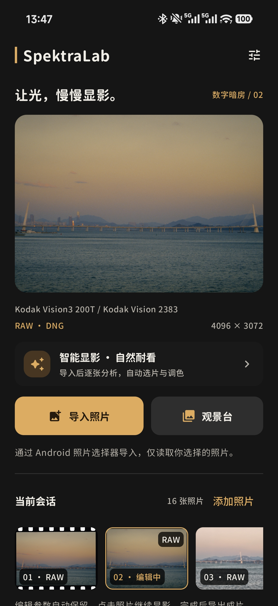
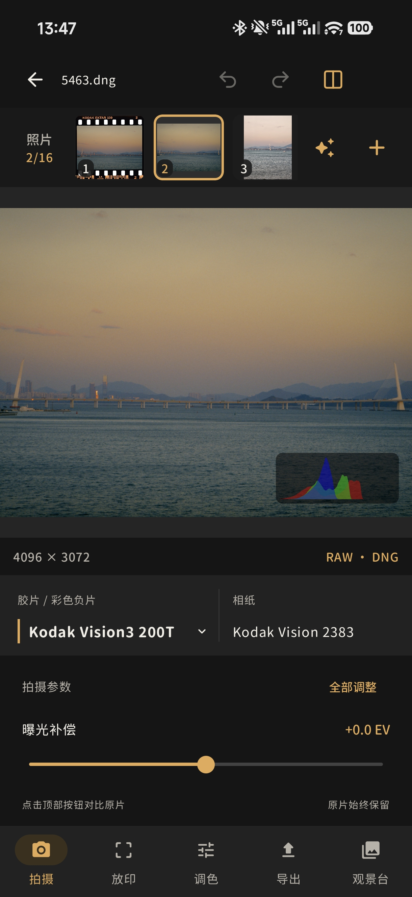
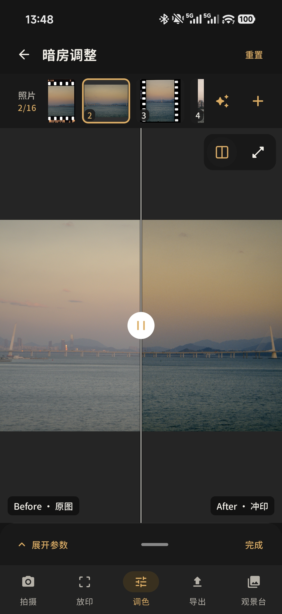
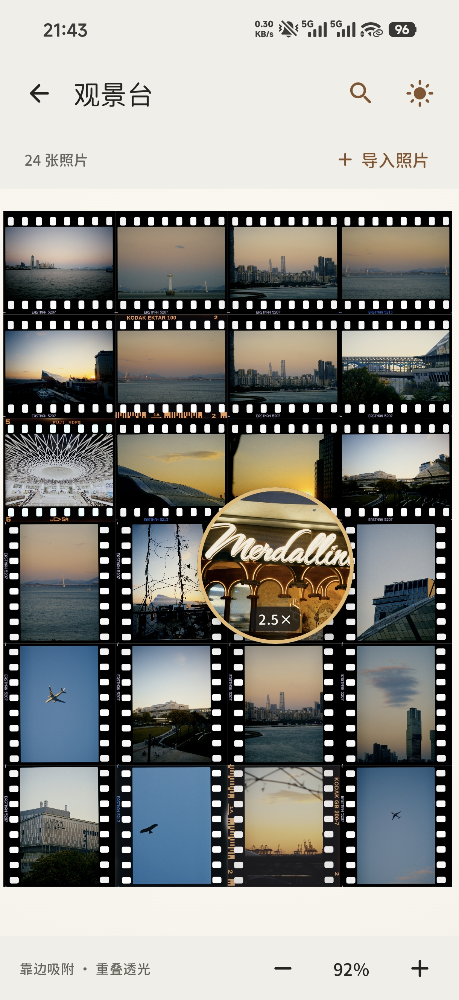
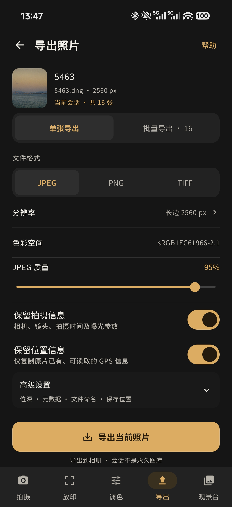

<div align="center">

# Theia

**Let the light develop, slowly.**

A digital darkroom in your pocket. Rediscover the light in your photographs through film and photographic paper.

[简体中文](README.md) · **English**

[Download](https://github.com/deepspyder/SpektraLab-Android/releases) · [Features](#features) · [Build from source](#build-from-source) · [License](#license)


[](LICENSE)

</div>

## About Theia

Theia is a free, open-source film and darkroom simulation app for Android, built on **[spektrafilm](https://github.com/andreavolpato/spektrafilm) by Andrea Volpato**. Import a photograph, pair a film stock with photographic paper, adjust its development, and save the result to your gallery.

It brings together RAW editing, per-photo Smart Develop, a multi-photo workspace, a free light table and batch export. Start with an automatic style, or work through the details yourself.

## Screenshots

<table>
  <tr><th>Workspace</th><th>Film development</th><th>Before / after</th><th>Light table</th><th>Export</th></tr>
  <tr>
    <td></td>
    <td></td>
    <td></td>
    <td></td>
    <td></td>
  </tr>
</table>

<sub>These are the newly supplied device screenshots. Some still show the former name, SpektraLab; the application is now named Theia.</sub>

## Features

| From import to finished image | What you can do |
| --- | --- |
| **Film × paper** | Pair color negative, reversal or black-and-white film with photographic paper and print settings to explore color and contrast. |
| **Per-photo Smart Develop** | Choose Natural, Cinema or Vintage. Each photograph receives its own film, paper and parameter recommendations, with manual adjustments available afterward. |
| **RAW and multi-photo workspace** | Import JPEG, PNG, WebP and RAW files, switch between top-row thumbnails, and keep separate edits for each photo. |
| **Darkroom controls** | Adjust exposure, white balance, grain, halation, vignette and color. Inspect the before / after view and use undo or redo. |
| **Composition and cropping** | Move the crop selection, rotate, flip and choose aspect ratios, including **2.39:1** and **1.85:1** cinema formats. |
| **Free light table** | Arrange photos freely, pan and zoom the canvas, join nearby edges, and inspect translucent overlaps with lamp controls and a movable magnifier. |
| **Flexible export** | Export JPEG, PNG, 16-bit TIFF and DI TIFF; select photos for batch export and independently choose whether to retain capture and location metadata. |

## Getting started

1. Download an APK from [GitHub Releases](https://github.com/deepspyder/SpektraLab-Android/releases) and install it on a 64-bit Android device with Vulkan support.
2. Import photographs and choose a Smart Develop style, or select film and paper manually.
3. Refine the image in the darkroom, explore your photos on the light table, and export the results.

> **Large-image export:** Prefer a smaller export resolution for very large photographs. Full-size export uses more memory and takes longer to process.

Requires Android 8.0 (API 26) or later. The build targets `arm64-v8a` and `x86_64`. Formerly SpektraLab Android, Theia retains the application ID `com.spektralab.android` for compatible upgrades and existing edit data. See the [rename notes](docs/theia-branding.md).

## Build from source

### Requirements

| Tool | Version / requirement |
| --- | --- |
| Android Studio | Android SDK Platform 36 installed |
| JDK | 21, verified in local builds |
| Gradle / Android Gradle Plugin | 8.13 / 8.11.2 |
| Kotlin | 2.1.0 |
| Android NDK / CMake | 27.0.12077973 / 3.22.1 |
| Python / glslang | Python 3.10+; `glslangValidator` or `glslang` on PATH |

### Prepare the shared engine

The Android app uses the shared C++20 / Vulkan engine through JNI. A complete build also needs the engine checkout, resources and LibRaw sources; this repository alone is insufficient for real rendering.

Default layout:

```text
workspace/
├── SpektraLab-Android/          # This repository; application name: Theia
├── SpektraLab-Windows/
│   └── engine/                 # Shared engine, profiles and shaders
└── deps/
    └── LibRaw-0.22.2/          # RAW decoding dependency
```

Keep these actual directory names. To relocate the engine, update CMake's `SPEKTRA_ENGINE_DIR`, the resource-sync argument and the shader script's input directory together. `SPEKTRALAB_LIBRAW_SOURCE` controls the LibRaw path. The shared engine includes `setup-libraw.ps1` to prepare LibRaw.

### Sync resources and build

Run from this repository's root:

```powershell
python tools/sync_resources.py
python tools/compile_shaders.py
gradle :app:assembleDebug
```

Alternatively, open the project in Android Studio, configure the SDK and build there. If you have generated a Gradle Wrapper, use `./gradlew` (`.\gradlew.bat` on Windows) instead of `gradle`.

Generated engine resources and SPIR-V files live in `app/src/main/assets/engine/resources/` and are ignored by Git. Release builds also need a local signing key and `keystore.properties`; keep private keys and passwords out of version control.

### Source layout

```text
app/src/main/
├── java/com/spektralab/android/  # Compose UI, editing state and exports
│   └── engine/                  # Kotlin engine and color wrappers
├── cpp/                         # JNI bridge, Vulkan engine and RAW decoding
└── res/                         # Theme, fonts and UI resources

docs/images/                     # Device screenshots used in this README
tools/                           # Engine resource sync and shader compilation
```

## Credits

- **[spektrafilm](https://github.com/andreavolpato/spektrafilm)** — Andrea Volpato's open-source film simulation project, an essential foundation for Theia.
- **[LibRaw](https://www.libraw.org/)** — RAW image decoding.
- **[Resource Han Rounded](https://github.com/CyanoHao/Resource-Han-Rounded)** — The rounded Chinese and Latin typeface used by the interface.
- **[Lucide](https://lucide.dev/)**, **[volk](https://github.com/zeux/volk)** and **[stb](https://github.com/nothings/stb)** — Icons and supporting open-source components.

Thank you to the upstream authors, contributors and everyone who tests the app and shares feedback.

## License

Theia application code continues under **GPL-3.0-or-later**. The full license text is in [LICENSE](LICENSE).

Original spektrafilm profiles, LUTs and their direct derivatives are licensed under **CC BY-SA 4.0**, with **Andrea Volpato** credited as the original author and [spektrafilm](https://github.com/andreavolpato/spektrafilm) as the canonical source. The original notice and terms are preserved in [SPEKTRAFILM_LICENSE.txt](licenses/SPEKTRAFILM_LICENSE.txt).

Third-party libraries, fonts, icons and other assets retain their respective copyrights and licenses. See [NOTICE.md](NOTICE.md) for attribution, license files and resource notices.
