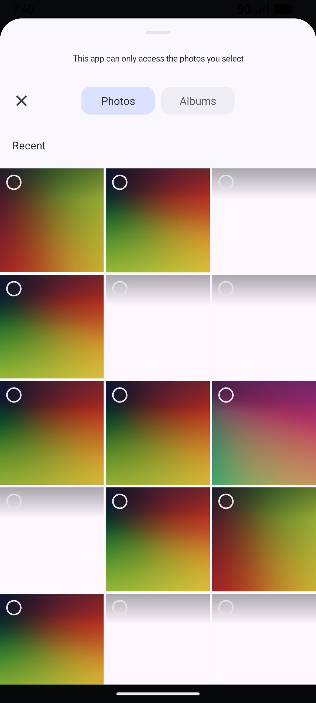
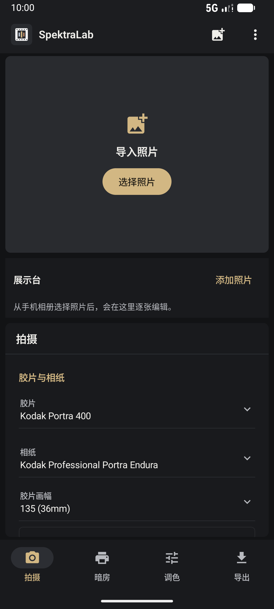
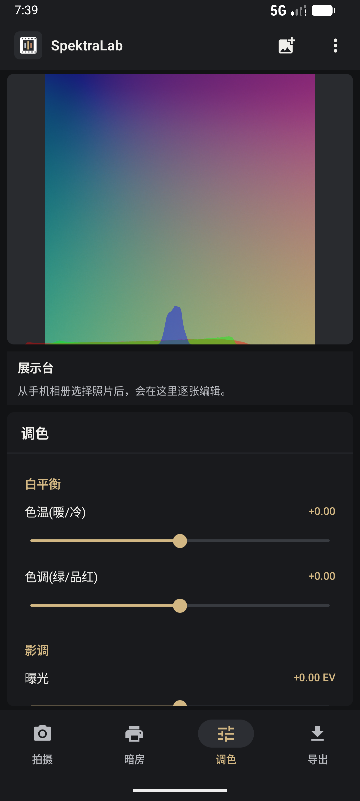
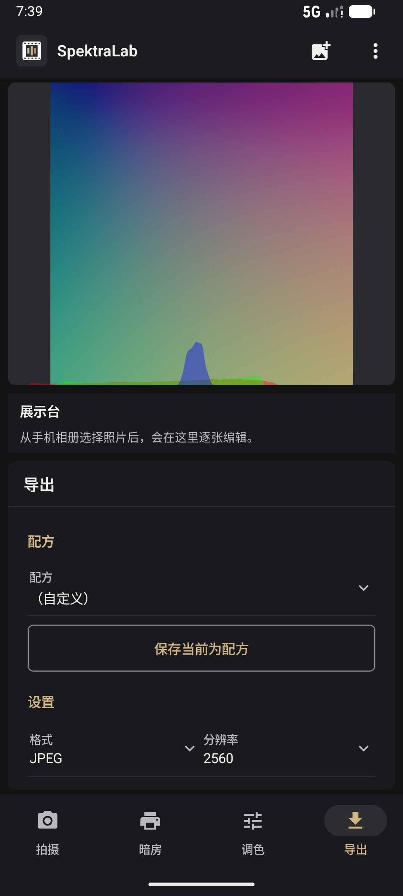

# SpektraLab Android

SpektraLab Android is a film and darkroom simulator for Android. It combines a Kotlin + Jetpack Compose editor with the SpektraLab C++20/Vulkan rendering engine through JNI.

Current release: **v0.1.3**. See the [release notes](docs/releases/v0.1.3.md).



## Features

- Film and photographic-paper simulation with film profiles and print LUTs.
- JPEG, PNG, WebP and RAW import, including LibRaw-based RAW decoding.
- Camera white balance, lens correction, crop, rotation and flip controls.
- Film grain, halation, glare, exposure, filters, latitude and color grading.
- Multi-photo stage with per-photo edits, thumbnails, EXIF information and removal.
- Light-table view with a white light-box surface, ruler marks, drag/zoom/pan, overlapping photos and magnifier inspection.
- Light-table export to PNG with Android save-to-gallery and system sharing.







## Architecture

```text
Jetpack Compose UI
        |
EditorViewModel
        |
EngineClient (Kotlin/JNI)
        |
libspektralab.so (C++20 + Vulkan + LibRaw)
```

The Android app reuses the engine and C ABI from the sibling `SpektraLab-Windows` checkout. The JNI bridge is in `app/src/main/cpp/jni_bridge.cpp`; the Kotlin engine wrapper is in `app/src/main/java/com/spektralab/android/engine/EngineClient.kt`.

## Build Requirements

- Android Studio with SDK Platform 36
- Gradle 8.13
- Android Gradle Plugin 8.11.2
- Kotlin 2.1.0
- NDK 27.0.12077973
- CMake 3.22.1
- Python 3 for resource scripts
- `arm64-v8a` or `x86_64` device/emulator

Open this directory in Android Studio. The project uses the real engine by default. The engine checkout is expected at `../SpektraLab-Windows/engine`. Override it with `-DSPEKTRA_ENGINE_DIR=/path/to/engine` when necessary.

## Resources and Shaders

```powershell
python tools/sync_resources.py
python tools/compile_shaders.py
```

The second command requires `glslangValidator`. Generated engine resources are intentionally ignored by Git. A clean checkout needs the sibling engine checkout and generated Android assets before a full real-render build.

## Project Layout

```text
app/src/main/java/com/spektralab/android/
  MainActivity.kt       Compose navigation and editor surface
  EditorViewModel.kt    editor state, photo workflow and exports
  ViewingStand.kt       Android light-table view
  engine/               JNI-facing engine and color pipeline wrappers

app/src/main/cpp/
  CMakeLists.txt        native build and engine source selection
  jni_bridge.cpp        JNI to SpektraLab C ABI bridge
  raw_decode.cpp        LibRaw Android bridge

docs/images/            README product screenshots
tools/                  resource and shader synchronization scripts
```

## Development Notes

The local CodeGraph index is used to navigate the Kotlin, C++ and JNI call graph during development. It is machine-local and should not be committed. The functional Android audit lives in `app/src/androidTest/java/com/spektralab/android/FunctionalAuditInstrumentation.kt`; QA captures are stored under `qa/`.

## License

Application code: GPL-3.0-or-later.

Film and paper product profiles: see the notices and license files shipped under `app/src/main/assets/engine/resources/`.

---

# SpektraLab Android（中文）

SpektraLab Android 是一款面向 Android 的胶片与暗房物理模拟器。应用使用 Kotlin + Jetpack Compose 构建编辑界面，通过 JNI 调用 C++20/Vulkan 渲染引擎。

当前版本：**v0.1.3**。查看[版本说明](docs/releases/v0.1.3.md)。


## 功能

- 胶片与放大相纸物理模拟，支持胶片配置和打印 LUT。
- JPEG、PNG、WebP 和 RAW 导入，RAW 使用 LibRaw 解码。
- 相机白平衡、镜头校正、裁剪、旋转和翻转。
- 颗粒、光晕、曝光、滤镜、宽容度和调色控制。
- 多照片展示台：逐张编辑、缩略图、EXIF 信息、照片移除。
- Android 观景台：白色灯箱背景、顶部/左侧刻度、拖动、缩放、平移、照片叠放和放大镜查看。
- 观景台导出 PNG，支持保存到系统相册和调用系统分享面板。


## 架构

```text
Jetpack Compose 界面
        |
EditorViewModel
        |
EngineClient（Kotlin/JNI）
        |
libspektralab.so（C++20 + Vulkan + LibRaw）
```

Android 端复用同级目录 `SpektraLab-Windows` 中的引擎和 C ABI。JNI 桥接位于 `app/src/main/cpp/jni_bridge.cpp`，Kotlin 引擎封装位于 `app/src/main/java/com/spektralab/android/engine/EngineClient.kt`。

## 构建环境

- Android Studio，SDK Platform 36
- Gradle 8.13
- Android Gradle Plugin 8.11.2
- Kotlin 2.1.0
- NDK 27.0.12077973
- CMake 3.22.1
- Python 3
- `arm64-v8a` 或 `x86_64` 设备/模拟器

使用 Android Studio 打开本目录。默认使用真实引擎，引擎目录为 `../SpektraLab-Windows/engine`。如需指定其他目录，使用 `-DSPEKTRA_ENGINE_DIR=/path/to/engine`。

## 资源与着色器

```powershell
python tools/sync_resources.py
python tools/compile_shaders.py
```

第二条命令需要本机安装 `glslangValidator`。生成的引擎资源默认被 Git 忽略；全新 checkout 需要准备同级引擎目录并生成 Android assets。

## 目录结构

```text
app/src/main/java/com/spektralab/android/
  MainActivity.kt       Compose 导航与编辑器界面
  EditorViewModel.kt    编辑状态、照片流程与导出
  ViewingStand.kt       Android 观景台
  engine/               JNI 引擎和色彩管线封装

app/src/main/cpp/
  CMakeLists.txt        native 构建和引擎源选择
  jni_bridge.cpp        JNI 到 SpektraLab C ABI 的桥接
  raw_decode.cpp        LibRaw Android 桥接

docs/images/            README 产品截图
tools/                  资源和着色器同步脚本
```

## 开发说明

开发过程中使用本地 CodeGraph 分析 Kotlin、C++ 和 JNI 调用图。CodeGraph 索引只属于本机，不应提交到仓库。Android 功能审计位于 `app/src/androidTest/java/com/spektralab/android/FunctionalAuditInstrumentation.kt`，QA 截图位于 `qa/`。

## 许可

应用代码：GPL-3.0-or-later。

胶片与相纸配置：以 `app/src/main/assets/engine/resources/` 中随附的授权和声明文件为准。
