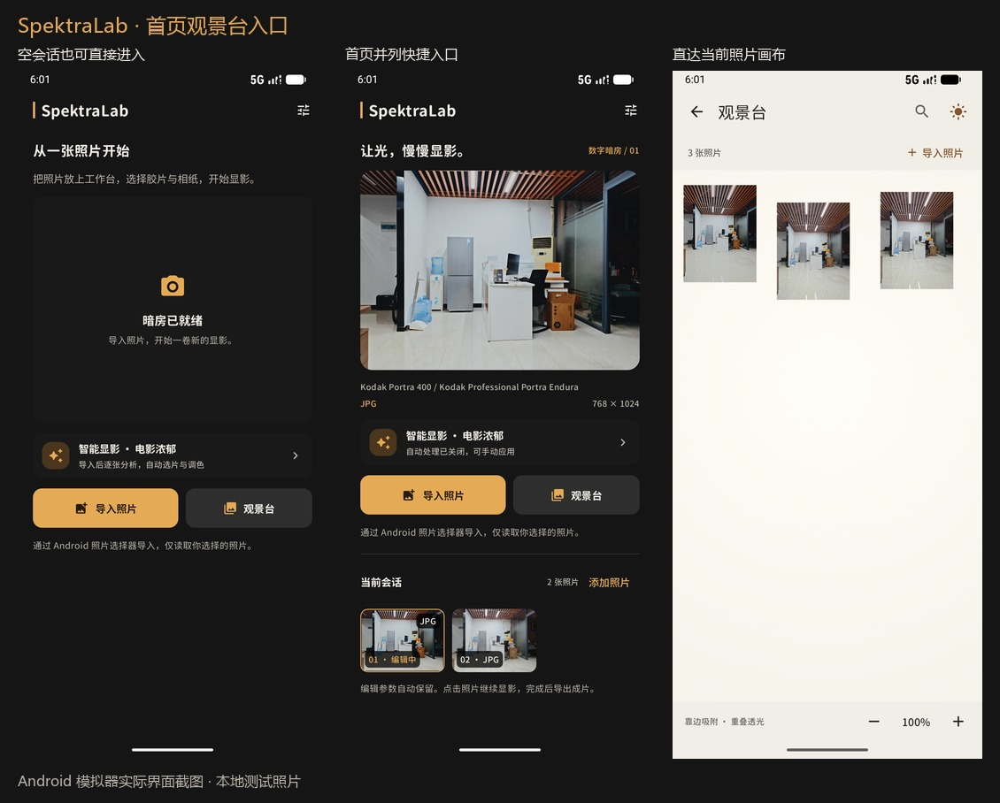
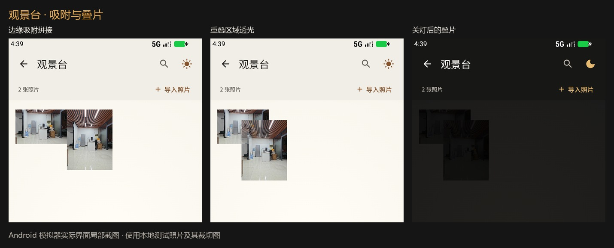
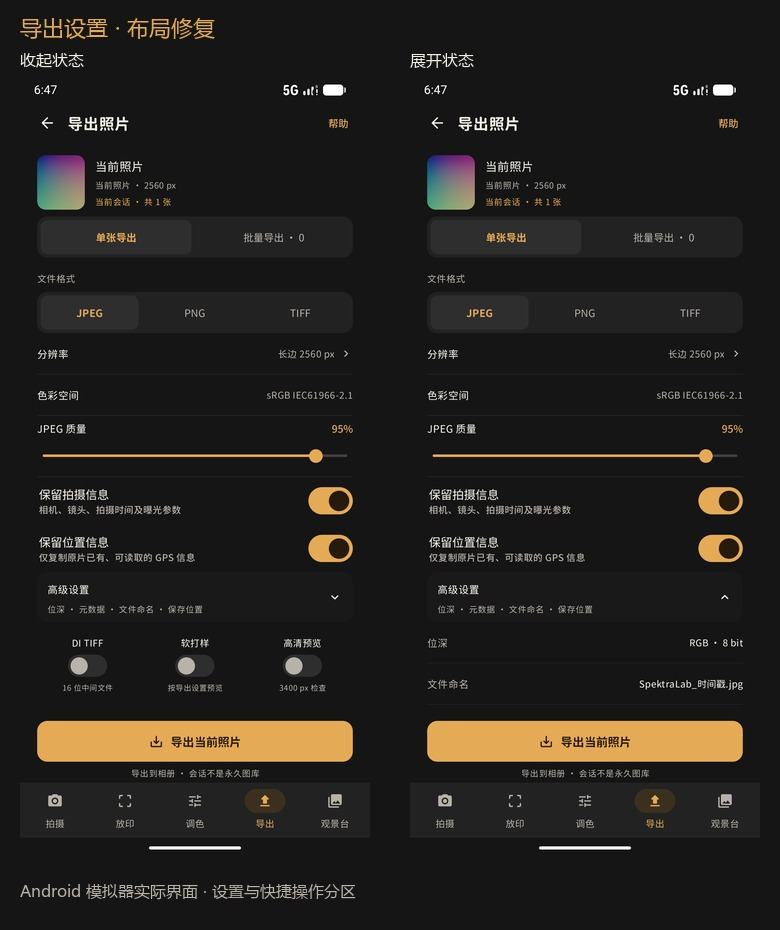

# SpektraLab Android v0.1.3

发布日期：2026-11-09。应用版本 `0.1.3`，内部版本号 `4`。

## 更新内容

- **智能显影**：自然耐看、电影浓郁、轻柔复古三种风格可选并记忆。每张新导入照片独立分析明暗、反差和色彩，选择胶片、兼容相纸与调色参数；自动处理可关闭，手动应用可撤销，已有编辑不会被导入建议覆盖。
- **观景台**：首页新增直达入口，与导入按钮并列；首页与编辑器共用画布摆放。照片靠边可吸附拼接，提供接缝预告与柔和过渡；重叠区域透光，照片可继续单独拖开。
- **放大镜修复**：拖动镜片不再带动下方照片或触发吸附；修复沉浸查看中镜片偏移、裁出屏幕的问题。
- **编辑与选片**：顶部常驻多照片缩略条，胶片库和相纸使用紧凑选择布局、圆润字体及透明标签素材。
- **裁剪与调色**：选区支持拖动，增加 2.39:1、1.85:1、自定义比例与暗角控制。
- **导出**：批量导出支持勾选照片；拍摄信息、位置信息可分别选择保留。高级设置与快捷操作重新分区，帮助里补充大图尽量避免全尺寸导出的建议。
- **RAW 与 TIFF**：沿用原生像素缓冲、受限预览和分段写入路径；智能显影补齐未打开照片的逐图批量导出方案。

本页汇总 v0.1.3 的主要更新、安装信息与验证说明。

## 安装包

- 文件名：`SpektraLab-Android-v0.1.3-universal.apk`。
- 仓库中的相同正式产物：[app/release/app-release.apk](../../app/release/app-release.apk)。
- 大小：54,949,934 字节，约 54.95 MB（52.40 MiB）。
- Android 8.0（API 26）及以上；`arm64-v8a`、`x86_64` 双架构，不包含 32 位 ARM。
- APK 签名验证通过，并与之前的正式安装包使用相同证书，可覆盖升级相同签名的旧版。

SHA-256：

```text
9dd783c5104acef845674376610bf2137e47120f51bdb6f7a78eb0dfbce8d894
```

签名证书 SHA-256：

```text
3df31b6b60a0e7edb705d495c086e28cb699883d1b29ceb723992b08ed43af39
```

## 验证

- Debug、AndroidTest、Release 构建和 Release vital lint 通过；两个 ABI 的原生库均完成构建。
- 最终 `0.1.3` 源码构建回归智能显影、观景台拼接和放大镜、首页观景台入口、导出布局及原有观景台流程。机器可读结果见 [v0.1.3-verification.json](v0.1.3-verification.json)。
- 功能开发期间已覆盖手机、1.3 倍字体、平板、横屏；吸附还覆盖关闭系统动画。最终版本回归在 x86_64 Android 模拟器上执行，不能替代不同 GPU、驱动或真机的大图压力测试。
- 签名、APK manifest 的版本号/系统要求/架构及 ZIP 完整性已检查。运行回归使用相同源码的 Debug 包；正式 Release APK 保留原签名。

## 使用说明与限制

- 大图优先选择长边 2048、2560 或 3840px 输出。原始尺寸导出仍可能带来较高的 native/GPU 内存压力，不能保证所有设备都能完成全尺寸 RAW 导出。
- 智能显影使用本地统计与规则，不进行语义场景识别，不宣称每张照片都能得到主观最佳效果。
- 观景台吸附仅改变画布摆放，不合并源文件，也不自动生成拼接成片。原片始终保留。
- 此版保持现有完整圆润字库和素材。此前试验的代码裁剪、资源裁剪与启动缓存优化已撤销；Release 代码裁剪仍关闭。

## 界面预览







以上为实际 Android 模拟器界面截图，使用项目本地测试照片；不代表所有设备的显示或性能。
