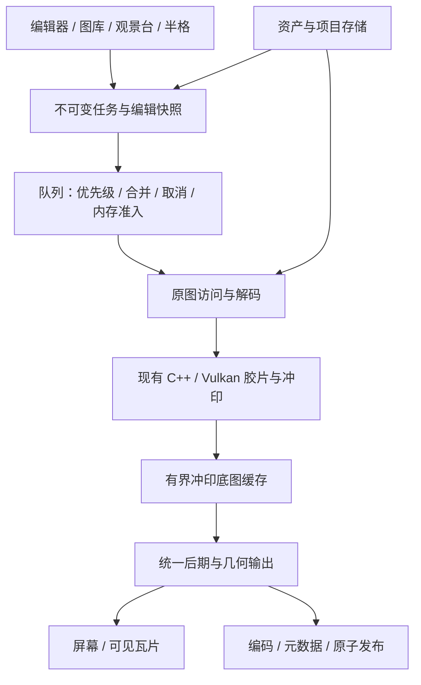

# Theia Android 功能演进与实施方案

> 合并 SpektraLab 2.3.2 的两份 Android 可行性分析，形成可分阶段实施、迁移和验收的方案。
>
> 日期：2026-11-11 · 状态：设计方案，尚未实施新增功能 · 产品名称：Theia

## 1. 结论与适用范围

采用 **保留当前 Android 可运行基线、逐项移植能力、先稳定性基础再扩展编辑和创作功能** 的路线。继续本地处理，不因移植新增云端渲染依赖。

本方案包含：渲染与缓存基础、完整成片调色、图库与虚拟副本、观景台项目与导出、半格双图、Decode 曲线、新胶片模型、专业输出，以及后续 HDR 等专项。不是一次性重写整个应用，也不是把 Mac 界面缩小后搬到手机。

依据：

1. 仓库内的[新原型可行性分析](upstream-2.3.2-android-feasibility.md)。
2. 本地补充分析：`E:/Code/SpektraLab/.tmp/spektralab-android-feature-analysis.md`。其有效结论已纳入本文，实施时不依赖该临时文件存在。
3. [现有全尺寸性能记录](full-resolution-performance.md)、[代码组织说明](architecture.md)与本轮核对的 owning source。

参照原型为本地 `SpektraLab` 检出 `1952c63`，发布提交标记为 2.3.2，日期 2026-11-10；未将其等同于已经在线确认的最新远端版本。Android 基线为 `2a6adef` 加当前未提交改动，实际依赖兄弟目录 `SpektraLab-Windows/engine`。本轮确认共享检出中的 `engine.cpp`、`pipeline.hpp` 也有本地修改；不能只用 Android HEAD 复现当前结果。

本次只新增方案文档，没有改业务代码、切换引擎、重新运行此前性能测试或提交 Git。后文所有阶段、模块、数据类型与验收项都是计划，不能作为已经实现的能力对外宣传。

## 2. 两份分析的统一与修正

| 议题 | 最终决定 | 原因 |
| --- | --- | --- |
| 先调色还是先性能 | 先做最小任务/缓存基础，再交付调色；不等待整个渲染引擎重写完成 | 避免新控件增加 CPU 扫图和并发压力，同时让用户较早得到新功能 |
| 图库放在哪一阶段 | 在持久观景台和半格项目之前建立最小资产/编辑身份；完整筛选随后扩展 | URI、照片和编辑不能长期用同一个身份表示，否则虚拟副本与项目引用会冲突 |
| 全尺寸瓦片 | 基础格式与缓存身份提前建立；完整细节显示分阶段接入 | 可见瓦片降低查看驻留，不等于首次整图显影已经低峰值 |
| 替换共享引擎 | 不直接改 CMake 指向新仓库，不整目录覆盖 | 新树缺少当前 Android 使用的部分管线/着色器，且有接口路径变化 |
| minilab | 排除在保持现有效果的性能补丁之外，列为可选研究 | 当前 `minilab/index.json` 只列出 Portra 400 / Portra Endura；会替换部分光学印放过程，不能视为所有组合可用或像素零差异 |
| 新版 bands | 不作为已完成的低内存执行器引用 | Mac `SpkEngine.render` 的 `.bands` 只计算计划进度，实际仍按整图执行 |
| Decode 曲线位置 | 语义是胶片前场景曲线，坐标为曝光补偿后的胶片档位 | 实际节点仍在 spectral upsample 与 exposure 节点之前，用补偿值计算增益；不能随意挪节点或当普通 0…1 曲线使用 |
| 半格独立参数 | 基础版支持每张原片独立解码、曝光和构图，共用胶片 look；独立冲印/调色作为后续层 | 两份分析的独立印放与统一 look 需要区分，避免第一版就混合两种负片模型 |
| 对比度遮罩 | 单列暗房引擎专项，不归为局部画笔蒙版 | 对应 contrast mask，不是任意区域涂抹编辑 |
| 后台导出 | 独立设计持久任务与平台执行宿主，不当作 Mac 已有能力移植 | 需要系统能力、取消、重启恢复与输出去重共同成立 |

### 2.1 必须保持的产品约定

- 保留 Theia 名称、现有应用 ID、JNI 所属类与签名；本方案不要求重新安装或丢失旧数据。
- 全尺寸导出不自动缩小，不降低位深、不关闭颗粒/光晕等效果，不使用近似路径冒充原有质量。
- 保留用户已选择的自由观景台，不改回强制网格；默认不额外给所有照片加边框。
- 延续圆润、紧凑的视觉语言及顶部多图工作台；本阶段不重做素材与图标。
- 保留原图按住对比、RAW 修复、元数据保留选项、批量勾选、现有裁剪比例及所有有效编辑。
- 反转片走扫描、黑白和彩色材料兼容规则保持有效；材质实测数据不能用来掩盖渲染问题。
- 新功能默认中性/关闭。历史编辑在升级后不因新字段、默认色域或公式变化而自动变样。

## 3. 功能范围、优先级与交付边界

P0 是可靠性和依赖基础，P1 是首批用户功能，P2 是后续增强，P3 是独立研究；不对应未经确认的发布日期。

| 编号 | 工作包 | 优先级 | 复杂度 | 交付边界 |
| --- | --- | --- | --- | --- |
| F01 | 基线、任务队列、版本化参数快照 | P0 | 中 | 统一排队、合并、取消和结果落地，保留现有引擎语义 |
| F02 | 缓存身份、限额与全尺寸缓存格式 | P0 | 中高 | 可靠失效、原子文件、有界驻留；不承诺首次全尺寸渲染峰值已解决 |
| F03 | 大图活跃峰值专项 | P0，贯穿 | 高 | 定位全局阶段与可分块性，验证后逐阶段改造；不阻塞所有独立小功能 |
| F04 | RGB/Luma/R/G/B 曲线、八色 HSL、自然饱和度 | P1 | 中高 | 参数、撤销、保存、预览和导出全部接通 |
| F05 | 通道混合、主色轮/三区色轮 | P1 | 中 | 保留旧三段 temp/tint 算法；新工具显式版本化 |
| F06 | 分组复制、目标选择、命名编辑预设 | P1 | 中 | 与导出配方分开；复制时默认保留目标构图 |
| F07 | 最小图库、相册、评级、色标、虚拟副本 | P1 | 中高 | 建立资产与编辑的独立身份，不复制大 RAW 创建变体 |
| F08 | 持久自由观景台、旋转、物理尺寸模式 | P1 | 中 | 保存场景坐标与照片引用；物理尺寸为可选模式 |
| F09 | 观景台海报、印样、透明 PNG 导出 | P1 | 中高 | 依据场景重新渲染，不用屏幕截图替代成品 |
| F10 | 半格双图项目与导出 | P1 | 高 | 两张原图、各自构图/解码/曝光，共用 look，可再编辑 |
| F11 | 全尺寸细节瓦片显示与软打样完善 | P1/P2 | 高 | 可见区域按需读取，正确管理色彩和过期帧 |
| F12 | 成片裁剪、关闭胶片后继续编辑 | P2 | 中高 | 与胶片前裁剪、按住原图比较分开定义 |
| F13 | Decode 场景曲线 | P2 | 高 | 新增 Vulkan 内核、wire、宽容度测量和失效测试 |
| F14 | CineStill 800T 与新版光晕 | P2 | 高 | profile、资源、背反射模型、高光策略一并验证 |
| F15 | Adobe RGB / ProPhoto、HEIF、可选无损 TIFF | P2 | 中高 | 真正编码/色彩转换与能力检测，不只改后缀/ICC |
| F16 | 导出任务恢复、前后台执行策略 | P2 | 高 | 持久任务、进度、取消、提交去重；不承诺任意时长后台存活 |
| F17 | 文案资源化与四语言 | 基础贯穿，翻译 P2 | 中 | 新文案先资源化，已有文案逐页迁移 |
| F18 | 同一负片多种冲印、contrast mask | P3 | 高 | 独立的分区/印放模型及 GPU 阶段 |
| F19 | HDR/Ultra HDR、RAW 高光余量 | P3 | 很高 | 从输入到屏幕和文件的完整链路，保留 SDR |
| F20 | minilab、Capture One、外部自动化 | P3 | 高 | 分别立项验证，不捆绑默认引擎升级 |

## 4. 目标架构：沿用现有分包，按职责增量提取

先保留单一 `:app` 模块与现有 JNI 入口。只有出现独立构建、复用或测试需要时再考虑 Gradle 多模块，不能为“模块化”一次引入多个服务、线程池或 DI 框架。

以下是建议职责与名称，落地时按当前代码边界调整：

| 包/位置 | 建议承载 | 边界 |
| --- | --- | --- |
| `feature.editor` | 编辑器会话、历史、选中照片、状态提交 | ViewModel 不直接管理所有缓存文件与图库 SQL |
| `core.model` | 编辑快照、版本、参数组、预设、源图/项目标识 | 持久值不依赖 Compose 可变状态 |
| `core.color` | 色彩描述、曲线表、HSL/通道/色轮数学约定 | 不依赖页面；不能只凭色域名字做转换 |
| `engine` | 单一引擎所有者、渲染队列、native handle、能力清单 | JNI 所属类兼容；所有 session 变更串行 |
| `data.cache`（新增） | 缓存索引、容量管理、原子文件与 tile reader | 不持有页面或 ViewModel；租约期间禁止删除使用中的文件 |
| `data.library`（新增） | 资产/变体/相册/项目元数据与 URI 授权 | 从 Android 存储身份映射到稳定 assetId |
| `data.local` | 旧 sidecar/recipe 兼容读取与迁移入口 | 迁移后只有一个写入者，防止数据库和旧文件互相覆盖 |
| `data.export` | 输出任务、编码、元数据、发布与恢复日志 | 像素转换与引擎计算分离，复用 `ExportPublisher` 的提交语义 |
| `feature.library` | 暂保留现有胶片/相纸库 | 新增照片图库可用 `feature.gallery`，避免同名概念混淆 |
| `feature.lighttable` | 自由画布模型、手势与合成场景 | 展示和导出共用布局计算 |
| `feature.pair`（新增） | 半格项目编辑和项目交互 | 合成数学/原生像素处理不写在 Composable 内 |

依赖方向保持 `app → feature → core/data/engine`；共享包不反向依赖页面。先定义不可变 `EditSnapshot` 作为任务输入，由现有 `EditorParams` 生成；不要求第一步把整个 Compose 状态模型重写。

这是目标职责图，不表示目前已经存在所有节点或每一步都必须读写磁盘。

## 5. 渲染、内存与缓存方案

### 5.1 渲染任务与所有权

每个任务至少包含：`taskId`、文档/项目 ID、源文件版本、不可变参数、编辑 revision、任务类型、目标像素、输出/工作色彩描述、引擎/算法版本、随机种子、取消令牌。

任务状态：`Queued → Preparing → Decoding → Rendering → Grading → Encoding → Committing → Completed`。按任务类型可以跳过阶段；另外有 `WaitingForResources`、`BlockedByCapacity`、`Cancelled`、`Failed`。状态必须说明等待原因，不能把失败伪装成永远转圈。

- 引擎 session 的 open/set/render/close 在一个串行执行器上；关闭会话与资源释放也经该所有者调度。
- LibRaw 解码采用有界并发，初始同一时间最多一个大 RAW 解码；不能为缩略图、预览、导出分别创建不受控的大图任务。
- 活跃编辑优先于预取；用户发起的导出可明确排队，不被缩略图填满。正在进行且不可安全中断的 GPU dispatch 等完成后再切任务，不能销毁仍被 GPU 使用的内存。
- 同一照片连续拖动合并为最新 revision；旧结果不得覆盖当前照片/新参数。不同照片、不同项目和不同输出不能误合并。
- 导出开始时冻结照片集合、顺序、编辑、配方和随机种子；用户后续切图不改变正在保存的任务。
- JNI 取消可独立发出，但 native 对象生命周期要与调用配合。超时监控用于诊断和阻止后续任务，不能在 GPU 仍使用资源时强制释放，不能保证 Java 异常能恢复失去响应的驱动。

### 5.2 缓存分层与键

| 层 | 缓存对象 | 键的关键内容 | 何时失效 |
| --- | --- | --- | --- |
| L0 | 源图头信息/矩阵/缩略图 | assetId + sourceRevision + 解码器版本 | 文件变化、权限变化、解码器语义改变 |
| L1 | 有界尺寸解码预览 | L0 + 白平衡/镜头校正 + 尺寸/方向 | 相应解码设置改变 |
| L2 | 冲印底图或其无损磁盘表示 | 源图/解码/胶片前几何 + 胶片/相纸/效果 + 物理画幅 + 种子 + 引擎/材质版本 + 尺寸 + 底图色彩描述 | 任意参与的参数或资源变化 |
| L3 | 后期预览/细节 tile | L2 + gradeVersion + 后期参数 + 成片裁剪 + 显示变换 + tile/级别 | 后期、显示或几何变化 |
| L4 | 项目合成所需图层/结果 | 子项目所有 revision + 场景版本 + 输出像素/变换 | 项目成员、子编辑或场景变化 |

键采用规范化序列化后哈希，不使用普通 JSON 属性插入顺序碰运气。浮点、负零、缺省字段、枚举和未知字段的处理写入版本合同。文件大小和修改时间只用于快速检查；不确定时补充内容指纹。云端源缺乏可靠版本时保守失效，不能重用可能属于旧文件的结果。

第一阶段优先缓存 native 已交付的 RGBA16 底图，保留每个样本原值；内部 float32 检查点是独立研究，不用 RGBA16 替代原本仍需 float32 的中间运算。只有数学阶段允许重用时才读缓存。

### 5.3 缓存容量与失败

- 所有内存、GPU 纹理和磁盘缓存分别计量，使用不同预算；不把 GPU ledger 当总物理内存。
- 初始不预取邻居全尺寸 RAW；图库缩略图只读展示所需像素。全尺寸同时只保留当前任务必要的底图/图层。
- 内存 LRU/磁盘 LRU 都有硬容量和条目上限；具体数值由目标手机基线确定，首轮交付报告必须记录默认值，不能照搬 Mac 系数。
- 读者持有文件/纹理租约；淘汰跳过正在读取的对象。写入临时文件并校验尺寸/长度/版本后原子更名。
- 缓存损坏、空间不足或读回失败，丢弃对应缓存并在资源许可时重算；不得改用低质量输出。可保留上一张正确预览并提示任务状态。
- 随机性只按现有规则版本化并显式持有种子，不为获得缓存命中率静默改变颗粒/眩光的随机约定。

### 5.4 真正降低首次全尺寸活跃峰值

现有记录中，24MP 临时缓冲活跃高水位约 2.06 GB，50MP 约 4.23 GB；这是历史模拟器引擎账本，不是本轮新测或手机物理内存数值。空闲池缩小与最终编码条带化不等于这些活跃峰值下降。

实施 F03 时按阶段列出输入、输出、临时 plane、活跃区间和同步边界，再分类：

1. 点运算：按条带输出，保持每像素公式/顺序；读写混叠和行末边界明确。
2. 全局统计：先完整流式归约，再处理像素；分块不能各算一套测光/最大值。
3. 有限核卷积：按实际支持半径带 halo，核由物理毫米与当前尺度计算，不能截断长尾来省内存。
4. IIR 等递推：保留跨块递推状态、双向 pass 与原边界条件，不能用一个有限 halo 代替整段状态。
5. 颗粒/随机场：按全局像素坐标与既定 seed 生成，跨块无重复、接缝或分布变化。
6. 需要整图的阶段：评估无损磁盘中间表示或算法等价的多 pass；在证据通过前仍明确标记整图限制。

修改前先有独立参考与边界回归。不能只测试条带输出与“同一个已经改过的整图算法”一致。GPU buffer range、分配上限、内存类型与同步规则同时验证。

任务无法在当前执行器/设备容量内运行时进入明确的受限状态，可取消、等待其他任务释放或由用户另选尺寸。**不能自动缩图继续称为全尺寸，也不能对无法解决的容量问题无限自动重试。**

### 5.5 全尺寸细节瓦片

先执行正确的全尺寸冲印任务并写入可定位的底图/tile，再按视口加载；若引擎暂不能局部计算，不把裁出一个 RAW 区域单独显影当作完整照片的一部分，否则测光、模糊和颗粒坐标会变化。

缩放先显示已有预览，细节完成后替换同一照片/参数 revision 的区域。只保留可见区域与少量边缘 tile；缩小时释放多余纹理。tile 的旋转、成片裁剪、色彩变换、直方图来源和像素倍率有统一定义。

## 6. 成片调色与编辑流程

### 6.1 先固定算法合同，再接控件

首批工具顺序：曲线 → 八色 HSL → 自然饱和度 → 通道混合 → 主色轮与三区色轮。每项都接入撤销/重做、单项重置、sidecar/图库保存、预设、参数复制、缩略图、细节与导出。

新 SDR 后期的逻辑顺序参考原型：白平衡 → 曝光/对比度/亮度 → 高光/阴影 → 黑白点 → 饱和度 → 自然饱和度 → HSL → 通道混合 → 色彩平衡 → 曲线 → 暗角。曲线内部是 Luma、RGB 总曲线、R/G/B 分曲线；曲线的存储表顺序不等于执行顺序。

这个顺序不能用来静默改写历史 Grade。实现时先记录现有 Android 数学、工作空间、灰点、clamp 和舍入规则；新操作为中性时跳过，保持 legacy 输出。需要改变既有公式或工作色域时引入明确的 `gradeVersion/colorPipelineVersion`，旧文档继续走旧合同，升级为新行为是显式编辑操作。

预览/全尺寸/tile/导出共用一个处理计划和色彩描述。首选复用 native/Vulkan 后期 pass；CPU 条带参考实现用于正确性核对或经过测量的有限工作，不让 Kotlin 全帧逐像素循环成为新交互主路径。验证未通过的 GPU 快速实现不开放给发布版。

| 工具 | 参数与行为要求 | 必测边界 |
| --- | --- | --- |
| 曲线 | 保存归一化控制点与插值版本，生成固定采样表；端点/单调 x、增加/删除/复位手势明确 | 直线中性、重复 x、越界点、拖动取消、每通道及高光端 |
| HSL | 八色控制与相邻颜色平滑权重，色相环绕；算法和权重版本固定 | 灰色/低饱和、红色跨 0°、重叠色区、全部归零 |
| 自然饱和度 | 区别于全局饱和度，保留原型算法定义 | 肤色/高饱和/中性灰/正负极值 |
| 通道混合 | RGB 3×3 矩阵，单位矩阵为中性 | 单通道、负系数、超范围值、灰阶 |
| 色轮 | 主色/阴影/中间调/高光独立；旧 temp/tint 值保留 | 色轮与旧值叠加、中性、区域过渡、色相环绕 |

### 6.2 参数复制与命名预设

新增参数组掩码：胶片/相纸、解码/白平衡、胶片效果、印放、后期光线、曲线、颜色、暗角、几何、片边/日期。默认不复制源图构图、源图元数据、日期自动取值结果、评级和文件身份。

复制到“选中的照片”，明确目标数量。预览和应用使用同一字段集合；批量持久化采用事务/可恢复批次，并保证已加载目标的历史与界面也同步。对不同 RAW 或不兼容材料的参数，给出具体跳过原因或合法配对调整，不能只写入无效 ID。

编辑预设保存参数模板和包含组，不保存 URI、assetId、一次性任务 seed 或导出目录。导出配方继续独立保存格式/质量/尺寸/色域/元数据等设置，UI 中分别称“编辑预设”和“导出配方”。

### 6.3 两级裁剪与胶片开关

胶片前裁剪影响测光、胶片画幅与效果尺度；成片裁剪只裁冲印后的结果。分别存储，撤销和复制范围明确，导出尺寸由所选阶段的结果计算。片边开启时不能悄悄覆盖用户构图；先建立 host crop、gate 和引擎 crop 的单一解析入口，再解除当前入口限制。

“应用胶片模拟”开关保存关闭前的胶片/相纸/片边状态，关闭后仍可做后期和导出；再次打开恢复设置。它不同于按住查看原图，按住比较不改变编辑模型或写入文件。

## 7. 图库、身份与迁移

### 7.1 最小数据模型

采用独立 repository，数据库推荐 Room/SQLite，具体依赖版本在实施时按工程兼容性核实。不把完整 RAW、浮点像素或大 tile 放进数据库。

| 实体 | 关键字段/关联 | 约束 |
| --- | --- | --- |
| `Asset` | assetId、sourceRevision、类型/像素/方向、可选 EXIF 摘要 | 代表一个源资产，独立于某次编辑 |
| `AssetLocation` | assetId、URI、provider/volume、权限、指纹、online 状态 | 同一资产可重定位；绝对路径不作跨安装身份 |
| `EditVariant` | variantId、assetId、schemaVersion、renderVersion、params、revision | 默认变体与虚拟副本只复制参数，不复制 RAW |
| `Album/AlbumMember` | albumId、variantId、排序 | 评级/标签归属首期按资产共享，编辑结果按变体区分，UI 明示 |
| `Session` | sessionId、variant 列表/顺序、当前项 | 恢复会话，不依赖进程内 photos 列表 |
| `LightTableProject/Item` | projectId、itemId、variantId、位置/旋转/z、布局版本 | 同一变体可多次放置，itemId 必须独立 |
| `HalfFrameProject` | projectId、两个孔位引用与 revision、布局、look | 缺源保持项目可打开，禁止用错误缓存冒充可导出 |
| `ExportJob/ExportItem` | jobId、不可变输入快照、状态、outputUri、commit 状态 | 用于恢复、去重与逐项失败处理 |

同一内容文件不自动合并为同一逻辑资产；只有满足身份合同才去重，避免把用户复制保留的两张图错误合并。重定位需核对尺寸/类型/指纹；文件名相同不是充分证据。

### 7.2 从旧 sidecar 的迁移步骤

1. 读取前备份迁移涉及的旧文件与会话索引，建立迁移版本及日志；不覆盖原片。
2. 封装现有 `EditStore`，从用户实际打开/导入的 URI 确认旧 key 到新 asset/variant 的对应。无法反推 URI 的历史 sidecar 保留为待关联，不删除。
3. 保存原参数语义、默认值、`gradeVersion` 和源图构图；缺少新字段全部中性。含无法理解的新版本字段时保留原数据并提示，不按旧格式重写丢字段。
4. 以事务插入资产、默认变体和迁移标记；文件写入使用原子替换。可重复运行，不产生重复变体。
5. 迁移成功的项由新 repository 单点写入；旧文件作为备份/兼容读取来源，不能长期双向写入两个权威副本。
6. 迁移中断、无空间或权限丢失时回到可读取的上一状态，保留用户编辑；清理备份不作为首个发布批次的自动行为。

保留应用身份和签名只保证覆盖安装条件，不自动保证所有存储身份有效；必须专测覆盖安装、重启、文件移动、云端 URI 与授权失效。

## 8. 观景台与项目导出

### 8.1 交互与持久场景

保留自由摆放、画布平移缩放、靠边吸附、叠加透光、灯光和放大镜。新增单图旋转、层级、项目保存与恢复。拖动/缩放使用临时状态，手势结束提交一次项目历史，避免每帧落数据库。

使用不依赖屏幕 dp 的场景坐标与布局版本；自由画布采用统一场景单位，物理尺寸模式使用毫米并明确映射。显示的“实际毫米关系”不承诺屏幕上绝对长度经过实体尺校准。进入物理模式是显式重排/缩放操作，能撤销，不能改变用户已有布局。

照片保留完整比例与方向，变换矩阵用于展示、命中、吸附、导出和放大镜。旋转后以真实轮廓处理吸附/遮挡；灯光、透明与重叠效果共用场景材质参数。是否显示胶片片边遵循单图编辑状态，不强制新增边框。

### 8.2 三种输出

| 模式 | 内容 | 文件与尺寸规则 |
| --- | --- | --- |
| 海报 | 场景 + 标题/日期等可选信息 | JPEG/PNG；首期给固定模板和明确长边像素 |
| 接触印样 | 仅照片/胶片布局，可选编号 | JPEG/PNG；导出前选画布范围/纸型和像素，不能把无限画布直接视为无限文件 |
| 含观景台 | 灯箱/边缘/阴影等场景 | 需要透明时 PNG；边缘与阴影的留白计入最终像素 |

从场景计算输出边界与像素预算，再按需求取得每张照片的冲印底图；不放大低清缩略图冒充高分辨率。无损可定位缓存允许逐层/逐带读取；纹理读取带旋转/滤波覆盖边界，防止条带接缝。

大尺寸输出要有增量编码器与有限行缓冲。当前 `Bitmap.compress` 不应被描述为已经具备整张项目的低峰值流式编码；在增量编码完成前，按实际可用预算开放项目尺寸，超出范围明确拒绝而不 OOM。编码库选型核对许可、ABI、16 KB 页兼容、元数据和失败清理，不因该功能引入不必要的大型图像 SDK。

“海报默认尺寸”和“原图全尺寸导出”是不同产品语义。导出页显示准确输出像素、格式、背景与预计空间；任务取消不公开半成品。

## 9. 半格双图方案

### 9.1 分两次交付

基础版：选择两张照片 → 各自构图/旋转/白平衡/曝光 → 选择横纵/左右顺序与间距 → 共用胶片/相纸/效果 → 可选片边和各自日期 → 预览/保存项目/导出。

增强版：每个孔位独立的冲印/后期，以及同一负片多次印放再组合。增强字段必须明确“每张照片”“整组胶片”的作用域，不能用最终拼贴掩盖不同印放语义。

### 9.2 数据与像素流程

- 项目引用 asset/variant 和最后采用的 revision，保存孔位构图与自身覆盖参数。子变体改变时标记待更新并提供明确更新行为；导出始终冻结两个孔位和共用 look 的快照，不能中途混用新旧设置。
- 按当前输出计算孔位像素与完整胶片毫米尺寸；预览与导出使用同一纯布局解析器，预览只改变采样密度。
- 每张图在自己的源图上解码/裁剪/应用曝光，串行释放 LibRaw 工作存储；把结果写入原生/有界中间表示。
- 合成线性空间的整片输入后交给引擎，整体自动测光关闭，由每张照片自己的测光/曝光决定。物理画幅、孔距、日期与片边需按 pair wire 明确传入。
- 基础版仍可能需要一张完整合成输入，不能宣传为两张大 RAW 在任意手机均能全尺寸合成。首期先测容量；需真正分块/磁盘执行的尺寸依赖 F03。
- pair 是可编辑项目；观景台吸附是场景摆放，两者不互相替代。删除一个原片后显示缺失孔位，恢复引用后可继续编辑；不导出已经失配的旧缓存。

跨平台 `.spektrapair` 导入/导出是独立互通任务：只有 schema、单位、源文件引用、日期及渲染版本可映射时才承诺兼容，不因使用同名扩展名宣称可互通。

## 10. 新引擎能力与专业色彩

### 10.1 每项移植的固定步骤

记录上游提交与资源指纹 → 拆出最小算法差异 → 检查现有本地改动 → 增补 schema/能力清单 → 实现 Android/Vulkan 路径 → 独立数学测试与原图回归 → 核对性能和内存 → 开放 UI。

保留当前 Android 的片边、日期、宽容度、DI、显示处理。上游缺少的文件不能删除；同名内核也不能只按文件名视为兼容。构建同时记录共享引擎 commit、工作树 patch 指纹、资源/shader/JNI ABI 版本，原片及签名私钥不进入这些记录。

### 10.2 Decode 曲线

与成片曲线分开模型/页面，命名为“场景曲线”并解释它改变进入胶片的曝光。参照上游 API 第 17 节：五行表的存储顺序为 rgb、luma、r、g、b；实际曲线执行顺序为 Luma → RGB → 分通道。原型使用 ±8 档坐标与 n=129 采样，轴是曝光补偿后的档位。

保留上游“节点物理位置在 exposure 前、增益计算包含补偿”的约定，不能把普通后期 0…1 曲线或简单的节点换序当作等价实现。增加 Vulkan 内核，测光/宽容度直方图与曲线后的统计同步；关闭/单位曲线维持原输出，正负曝光补偿下必须验证局部曲线的位置。

### 10.3 CineStill、contrast mask 与 minilab

CineStill 需移植新背反射/高光参数和相应 shader，不能单独发布 JSON。contrast mask 需补全阶段和缓存失效，不在当前未支持的路径上只显示开关。

minilab 当前只有一个登记组合，且改变部分印放字段的效力。本路线默认不启用；若未来采用，作为明确的新渲染版本/可选模式，以自己的参考图、控件说明和迁移测试验收，不修改旧编辑的默认物理输出。

### 10.4 输出色域与软打样

先保持当前 sRGB/Display P3 导出行为。新增色域时建立显式工作空间、传递函数、灰点、范围、输出矩阵/曲线/ICC 合同；不能把编码后的 sRGB 数字贴上 Adobe RGB/ProPhoto 标签，也不能直接在 ProPhoto 编码值上套为 sRGB 标定的 Grade。

预览和文件均从同一工作结果分支，屏幕分支做显示变换，文件分支做目标变换与一次最终量化。若引入新的宽色域后期链路，使用新的 `colorPipelineVersion`，旧文档保留旧路径。DI 密度数据不按普通显示 RGB 打 ICC。

软打样显示所选输出配方的模拟结果与必要的超色域提示；需要 ICC 渲染意图/黑点补偿等能力时另行确认实现，不把当前“高清预览”直接重新命名为完整 ICC 软打样。

### 10.5 HEIF、无损 TIFF、HDR 与后台

- HEIF：实施时核对目标 SDK/设备编码能力、色彩与 EXIF 支持；不可用时禁用该格式并解释，不悄悄改存 JPEG。既定 JPEG/PNG/TIFF 路径继续工作。
- TIFF 压缩：提供显式无损选项，验证解压后的每个 16 位样本；文件全体哈希可以改变。压缩是否更快由实测决定，不把减少体积等同于减少耗时。
- HDR：分别验证 RAW 输入高光保留、胶片扫描模型、float/headroom、屏幕显示和 gain map 文件。当前兼容 RGB16 解码中已经裁掉的高光不能在输出阶段恢复；EDR 参数、HDR 屏幕和 Ultra HDR 文件不是同一能力。
- 后台：任务和进度先持久化，再按实施时核实的 Android 平台规则选择前台服务/长任务执行方式。系统中止后重跑未完成项；不宣称可恢复任意 GPU 指令位置。
- 输出恢复：一个 ExportItem 一个提交身份，记录 pending URI 与已提交结果。MediaStore 提交和应用数据库不在同一事务里，重启时核对状态再决定续跑，避免重复导出/误删已经保存的文件。
- 目录：使用用户授权的 URI/目录，不复制桌面任意路径访问模型；处理失效权限、离线目录和原图重定位。平台版本约束作为实施前检查项，本方案没有完成新一轮在线核实。

## 11. 页面与交互接入

保留现有导航和视觉风格，按功能逐步接入；不为了完整移植增加一排难以理解的顶级入口。

| 位置 | 新增入口 | 交互约定 |
| --- | --- | --- |
| 编辑器顶部工作台 | 保持多图切换，增加选中目标/变体入口 | 切图保留缩放和编辑语义，旧任务不能替换新照片 |
| 成片编辑面板 | 光线、曲线、颜色、几何 | 当前工具展开，其他折叠；新工具不压缩照片可视区域 |
| 编辑器操作菜单 | 复制设置、应用预设、创建副本、关闭胶片 | 复制显示参数组和目标数；按住原图继续独立使用 |
| 首页/照片图库 | 最近会话、相册、评级筛选、项目 | 与现有胶片/相纸库区分命名 |
| 观景台工具条 | 旋转/层级/保存/导出 | 不默认打开片边，不强制整理用户布局 |
| 半格创建入口 | 从选中的两张照片创建 | 首次仅允许两张，明确提示每张/整组作用域 |
| 导出页 | 准确尺寸、目标格式/色域、元数据、队列 | 能力不足说明具体原因；完整保留现有拍摄/GPS选项 |

新文案先进入资源文件，避免继续散落中文字符串。手势工具支持明确的取消/完成、单项复位和无障碍数值输入；控件圆润不代表裁掉照片真实边缘。

## 12. 阶段计划与依赖

阶段以“可验收交付”结束，不按日历硬定版本号。复杂度是相对评估，不是已经测定的人日。

| 阶段 | 内容与产物 | 前置依赖 | 完成门槛 |
| --- | --- | --- | --- |
| S0 基线固定 | 记录两仓库工作树、资源与构建身份；归档现有修复和测试证据 | 无 | 可从记录重建并说明所有本地补丁，旧功能覆盖安装可回归 |
| S1 最小渲染基础 | EditSnapshot、任务身份/串行所有者、合并取消、缓存键/限额、分阶段日志 | S0 | 旧图像不变；切图/取消/导出状态正确；资源可回收 |
| S2 编辑能力首批 | 曲线、HSL、自然饱和度，随后通道/色轮、分组复制与预设 | S1 | 预览/导出/持久化/撤销覆盖，无 legacy 默认漂移 |
| S3 资产与图库核心 | asset/variant/session、迁移；相册/评级/色标/筛选 | S0；接入 S1 任务身份 | 升级不丢编辑、虚拟副本不复制 RAW、失效源可重定位 |
| S4 观景台项目 | 持久场景、旋转、海报/印样输出、可选物理尺寸 | S1 + S3；高像素依赖 F03 | 布局往返稳定，导出来自正确图像，透明/灯光/旋转一致 |
| S5 半格双图 | 项目模型、两个孔位独立设置、共用 look、日期/片边和输出 | S1 + S3 + 项目布局基础 | 子图身份/曝光/缺源/输出尺寸正确；不并存多个解码大 plane |
| S6 深入编辑/引擎 | 成片裁剪、胶片开关、Decode 曲线、CineStill、细节 tile 完整接入 | S1/S2；新增算子独立 gate | 上游差异可追踪，既有片边/日期/RAW 不退化 |
| S7 专业输出 | 宽色域与软打样、HEIF/压缩 TIFF、后台任务恢复 | S1 + S3；色彩依赖 S2 合同 | 文件/ICC/像素/元数据验证，取消与重启不重复保存 |
| R1 容量专项 | 逐阶段降低全尺寸活跃峰值 | S0 开始，贯穿 S1…S7 | 每个改造点有独立等价性证据和真机资源测量 |
| R2 后续研究 | HDR/contrast mask/独立印放/minilab/桌面互通 | 对应前置成熟后 | 不影响默认路径，独立说明支持范围 |

S3 的数据设计可在 S2 中独立推进，但先定义序列化/字段语义再实现迁移，避免两个阶段重复定义版本。S4 与 S5 共用项目资产与布局基础，分别验收，不要求第一批同时上线。R1 若未解决某个大尺寸上限，相关项目导出必须如实限制，不阻止已验证尺寸的独立功能发布。

### 12.1 第一批具体开发任务

1. **T00 基线清单**：记录 app、共享引擎、shader、profile、JNI 身份及未提交 patch，确认原有改动归属。产物为可复现清单，不自动提交或覆盖文件。
2. **T01 编辑快照**：从现有 EditorParams 生成不可变快照，暂不改变界面状态结构。验证序列化往返与历史复制一致。
3. **T02 单一队列接线**：先接现有单张导出/预览，再接批量/缩略图；核对顺序与取消，不一次替换全部 ViewModel。
4. **T03 底图缓存**：先只支持一种明确的无损 native 底图表示和一个活动任务，完成版本/损坏/容量/租约测试后扩展 tile。
5. **T04 曲线垂直切片**：先 RGB/Luma，再分通道，一次完成控件、历史、保存、复制和导出；使用现有照片墙/导出回归确保不退化。
6. **T05 HSL/自然饱和度**：在同一后期合同上接入，不增加第二套预览或导出算法。
7. **T06 数据迁移原型**：用复制的 sidecar/测试库验证资产/变体映射，确认后再连接正式入口。

## 13. 验收方案

### 13.1 所有工作包共同门槛

每个 PR/改动说明包含：用户触发方式、行为变化、旧数据影响、算法/资源版本、测试输入和设备、功能验证结果、耗时与内存口径、已知边界、回退方式。实现事实、历史测量、目标值分开写。

- 中性新参数不改变现有输出；旧 sidecar、recipe、默认胶片、裁剪、日期和元数据选项保持语义。
- 图像比较固定输入、种子、参数、目标尺寸与空间。确定性路径做样本/像素比较，随机路径固定种子或做分布检查，不用模糊缩略图证明颗粒一致。
- 缓存命中与强制重算结果一致；改变任意关联字段正确失效，改无关 UI 状态不错误失效。
- 导出前后预览/历史/当前照片不被后台任务覆盖；下一次编辑可继续工作。
- 失败清理、磁盘不足、授权失效、取消、进程重启和重复操作都不会破坏原片、留下可见半成品或重复提交。
- 构建 Debug、androidTest、签名 Release；包边界、diff 空白与相关 native/shader 检查通过。新增功能按最窄覆盖运行，集成边界运行既有核心回归。

### 13.2 专项测试矩阵

| 领域 | 输入/场景 | 必须记录的结果 |
| --- | --- | --- |
| 兼容 | 旧 sidecar/配方、未知字段、损坏文件、迁移中断 | 恢复前后参数/像素、单点写入、备份与幂等性 |
| 调色 | 灰阶/色卡/肤色/高饱和/高反差，sRGB/P3 | 算法参考误差、预览/导出变换、历史中性输出 |
| RAW | 既有 Z6II NEF、50MP DNG、改扩展名 DNG；seekable/pipe/云端 | 解码尺寸/方向、白平衡、取消、权限与临时清理 |
| 几何 | 横竖长图、2.39:1/1.85:1、旋转/翻转、两级裁剪/片边 | 完整比例、像素尺寸、物理尺度与命中/导出一致 |
| 项目 | 旋转重叠透明、相同 variant 多次放置、缺源、左右交换 | 持久往返、z 序、透明边缘、日期/孔距、源 revision |
| 全尺寸 | 24MP/50MP 单张及连续批量，冷/热与缓存命中/未命中 | 各阶段时间、ART/native、GPU 活跃/空闲、磁盘和异常日志 |
| 输出 | JPEG/PNG/TIFF、P3/DI、拍摄/GPS组合；后续 HEIF/HDR | 文件签名、可解码性、尺寸、位深、ICC/元数据、提交原子性 |
| 生命周期 | 切图、旋转屏幕、前后台、取消、进程被终止后重开 | 会话恢复、任务重新核对、无重复媒体项、native 生命周期安全 |

### 13.3 性能与真机门槛

基线使用同一优化级别、输入、参数和设备，冷/热分开报告，前后交错测量并保留多次样本；一次 Debug 与一次 Release 的差异不能作为优化成果。

性能目标是：旧路径没有持续内存增长或无解释的明显退化；交互不为每次滑动重新显影；缓存命中可证明跳过了相应计算；高像素项目不同时展开全部原片。具体每阶段预算和可公开尺寸在 S0/S1 真机测量后写入验证清单，不先编造“全尺寸一秒”或某个统一 MB 上限。

目标设备优先小米 17 Pro，覆盖可获取的不同 RAM/系统版本；另至少一台不同 GPU 家族设备验证 Vulkan/颜色/生命周期。真机不可用时可继续模拟器数学/功能测试，但涉及驱动、HDR、峰值与后台的结论标记未验收，不以模拟器通过替代。

## 14. 发布、回退与未决项

以工作包拆分提交/PR，算法迁移、数据迁移、界面接入和资源更新在说明中可追踪。需要同时上线才能保持合同的部分同一交付；避免只提交 UI 开关而发布版没有实现。

- S0 先整理现有未提交修复的边界与可复现证据，提交与 push 仍由后续明确请求决定。
- 新能力用内部 gate/能力清单逐项开放，不新增普通用户看不懂的“引擎模式”设置。能力清单不足时隐藏或解释未支持选项。
- 数据迁移回退以保留可读旧记录/备份为前提；不能默认降级安装可读取新版数据库。发布前实际验证迁移与恢复，不只关闭 feature flag。
- 算法回退恢复旧版本处理器与缓存命名空间；不能用旧 shader 读取新资源。缓存可以重建，用户编辑与项目不能因回退删除。
- 应用版本/发布日志只在实际交付时制定，不为方案文档提前升版本或上传安装包。

实施前需实测/定稿的事项：

| 项目 | 默认方向 | 必须何时确认 |
| --- | --- | --- |
| RAM/GPU/磁盘缓存初始限额 | Android 实测分项预算，首期保守不预取全尺寸 | S1 集成验收前 |
| 新后期 GPU 接口与数值误差门槛 | 优先 native/Vulkan，legacy 精确保留；新数学按独立参考定门槛 | S2 算法接线前 |
| 增量图像编码实现 | 有界内存、许可兼容、真实格式/元数据 | S4 大尺寸导出开放前 |
| 图库持久库版本/迁移细节 | Room/SQLite，唯一写入者，迁移可重入 | S3 连接正式数据前 |
| 反转/黑白/片边下 pair 支持范围 | 每组合显式能力与测试，无效组合不开放 | S5 发布前 |
| Android 后台/HEIF/HDR 平台条件 | 依据目标系统与官方资料、真机探测再确认 | 各专项实现前 |
| 新增第三方代码/材质许可 | 保留现有归属，核对代码/资源各自许可与分发要求 | 引入依赖/资源前 |

## 15. 源码核对索引

以下路径均相对 `E:/Code/SpektraLab`；用于区分事实与设计，不要求将三个仓库物理合并。

| 结论 | owning source |
| --- | --- |
| Android 实际引擎路径/源文件 | `SpektraLab-Android/app/src/main/cpp/CMakeLists.txt` |
| 旧参数、复制与片边居中裁剪 | `SpektraLab-Android/app/src/main/java/com/spektralab/android/core/model/EditorParams.kt` |
| 旧 per-photo 持久化 | `SpektraLab-Android/app/src/main/java/com/spektralab/android/data/local/EditStore.kt` |
| 现有自由画布与吸附 | `SpektraLab-Android/app/src/main/java/com/spektralab/android/feature/lighttable/FilmContactCanvas.kt` |
| 当前导出恢复、发布与性能证据 | `SpektraLab-Android/docs/full-resolution-performance.md` |
| 现行 Mac 主体与两层编辑 | `SpektraLab/ARCHITECTURE.md` 第 7 节，`app/SpektraLab/PAGES.md` |
| 原型调色公式/顺序 | `SpektraLab/app/SpektraLab/Sources/Model/Adjustments.swift`、`Sources/Engine/Layer2Kernel.swift` |
| bands 计划与真实整图执行 | `SpektraLab/app/SpektraLab/Sources/Scheduler/SpkEngine.swift`、`CostModel.swift` |
| Decode 曲线语义与 minilab 控件边界 | `SpektraLab/API-SPEC-callable-render-service.md` 第 17、18 节 |
| 当前 minilab 登记组合 | `SpektraLab/engine/resources/minilab/index.json` |
| 原型半格独立设置与模型 | `SpektraLab/app/SpektraLab/PAIR-WIRING.md`、`Sources/Engine/PairDevelop.swift` |
| 原型观景台尺寸与导出 | `SpektraLab/app/SpektraLab/Sources/LightTable/LightTableSizing.swift`、`LightTableExportPlan.swift` |
| 新树 Vulkan 未移植能力 | `SpektraLab/engine/src/pipeline/windows_unported.hpp` |

本方案以本文的统一决定、依赖顺序和交付门槛为准；两份可行性分析保留为分析记录，不再分别作为不同实施顺序使用。
